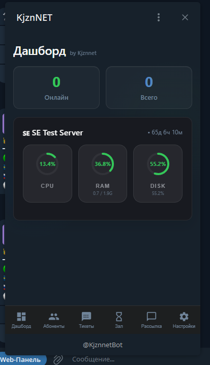
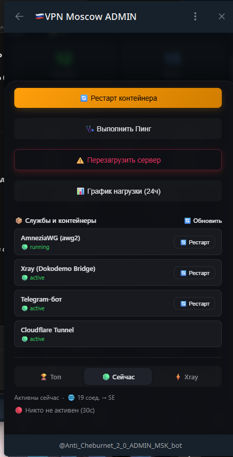
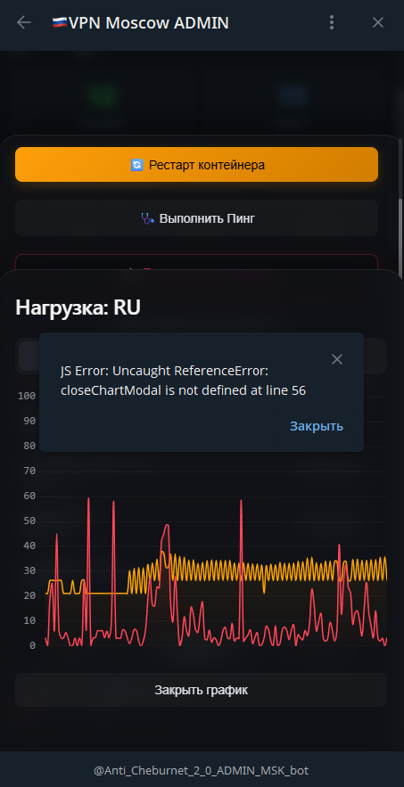
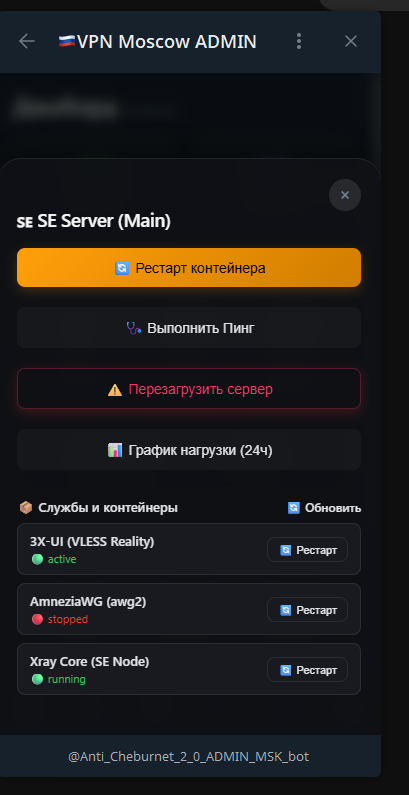
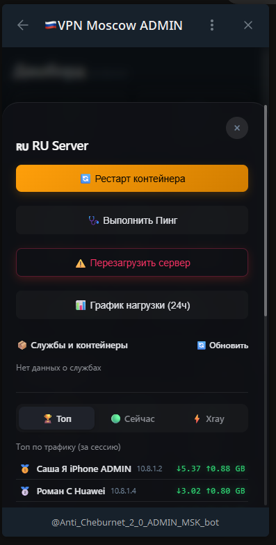

# 🚀 KJZNNETx VPN Telegram Bot & WebApp 2.0

Современная многосерверная система управления VPN-сетью (**AmneziaWG**, **Xray Reality / Dokodemo**, **WireGuard**) с интерактивной панелью **Telegram Mini Apps (WebApp)**, умным биллингом и точным аппаратным шейпером скорости (QoS).

---

## 📸 Скриншоты интерфейса

| Дашборд серверов | Управление абонентами | Аналитика и графики |
|:---:|:---:|:---:|
|  |  |  |

| Управление сервером и службы | Мониторинг сессий и Xray |
|:---:|:---:|
|  |  |

---

## 🌟 Основные возможности

* 📱 **Интерактивный WebApp Дашборд:** Графика нагрузки серверов (CPU, RAM, диск, сетевая активность в реальном времени), детальная статистика по клиентам, управление ключами и тарифами в 1 клик.
* 🌐 **Многосерверная архитектура (SE + RU):** Поддержка локальных контейнеров и удалённых нод через защищённые SSH ControlMaster соединения с автоматическим переиспользованием сокетов.
* ⚡ **Аппаратный шейпер скорости (QoS):** Управление полосой пропускания через Linux Traffic Control (`tc`):
  * **Загрузка (Download / Egress):** Классы `HTB` с точным соответствием `rate == ceil` (исключает овербукинг и неконтролируемые всплески).
  * **Отдача (Upload / Ingress):** `Ingress policing` со строгим отбрасыванием пакетов (`action drop`) сверх установленного лимита (10 / 30 / 50 / 100 Мбит/с).
* 🔄 **Автоматическая синхронизация имён:** Чтение `/opt/amnezia/awg/clientsTable` и автоматическая подгрузка имён клиентов, созданных в приложении Amnezia.
* 💳 **Биллинг и уведомления:** Учёт сроков подписки, автонапоминания абонентам об оплате и возможность мягкого ограничения скорости при неуплате.
* 🛡️ **Безопасность:** Аутентификация администратора через криптографическую валидацию Telegram `initData` (HMAC-SHA256). Все чувствительные данные изолированы в `.env` и никогда не попадают в систему контроля версий.

---

## 📋 Системные требования

* **ОС:** Ubuntu 22.04 / 24.04 LTS или Debian 11 / 12.
* **Python:** 3.10, 3.11 или 3.12.
* **Docker:** Установленный Docker Engine.
* **VPN-контейнер:** AmneziaWG (образ `amnezia-awg2` или `spcfox/amnezia-wg-easy`, развернутый через приложение Amnezia).
* **Сетевые утилиты:** `iproute2`, `qrencode`, `curl`.

---

## 🚀 Установка

### 1. Клонирование репозитория
```bash
git clone https://github.com/StigMary/Bot-Amnezia-WG.git /opt/vpn_bot
cd /opt/vpn_bot
```

### 2. Запуск автоматического установщика
```bash
chmod +x install.sh update.sh
./install.sh
```
*Скрипт проверит Docker, создаст виртуальное окружение `.venv`, установит библиотеки, подготовит структуру директорий и запустит интерактивный мастер настройки.*

### 3. Интерактивная настройка (Wizard)
Если вы хотите повторно настроить бота или сконфигурировать токены:
```bash
python3 manage.py setup
```
Мастер спросит токен Telegram-бота от [@BotFather](https://t.me/BotFather), ваш Telegram ID и автоматически определит локальный Docker-контейнер AmneziaWG.

### 4. Запуск служб
```bash
sudo systemctl restart vpn-bot vpn-webapp
```

---

## 🖥️ Управление серверами (Dynamic Nodes)

Система поддерживает **любое количество VPN-серверов** (1, 2, 3, 5+).

### Как добавить новый сервер:
Выполните интерактивную команду:
```bash
python3 manage.py add-node
```
Мастер запросит:
1. Имя сервера (например: `🇳🇱 Нидерланды` или `🇩🇪 Германия Exit-Node`).
2. IP-адрес или домен.
3. SSH-порт и пользователя (с беспарольным sudo).
4. Протестирует SSH-связь, автоматически добавит сервер в `.env` и перезапустит бота. Новый сервер сразу появится на дашборде WebApp!

### Список серверов и их онлайн-статус:
```bash
python3 manage.py list-nodes
```

### Проверка здоровья системы (Self-Test):
```bash
python3 manage.py test
```

---

## ⚙️ Конфигурация (.env)

| Переменная | Обязательная | Описание |
| :--- | :---: | :--- |
| `BOT_TOKEN` | **Да** | API-токен бота от [@BotFather](https://t.me/BotFather). |
| `ADMIN_ID` | **Да** | Числовой Telegram ID администратора (узнать в [@userinfobot](https://t.me/userinfobot)). |
| `ADMIN_API_KEY` | Нет | Секретный токен для внешнего API-доступа к FastAPI (для выгрузки бэкапов и автоматизации). |
| `GROUP_CHAT_ID` | Нет | ID закрытого канала/чата (если включена проверка подписки абонента, иначе `0`). |
| `WEBHOOK_URL` | Нет | Публичный HTTPS-адрес панели (Cloudflare Tunnel или ваш домен) для кнопки WebApp. |
| `NODE_1` | Нет | Описание сервера #1 в формате `ИМЯ\|local(или IP)\|PORT\|USER\|CONTAINER\|IFACE`. |
| `NODE_2`..`NODE_20` | Нет | Дополнительные удаленные серверы, подключенные по SSH. |
| `PAYMENT_DETAILS` | Нет | Текст реквизитов для оплаты (показывается абонентам в боте). |
| `PAYMENT_AMOUNT` | Нет | Стоимость подписки (например, `150 руб./мес.`). |

---

## 🌐 Настройка WebApp в Telegram

1. **Публикация порта 8080 через Cloudflare Quick Tunnel:**
   ```bash
   cloudflared tunnel --url http://127.0.0.1:8080
   ```
   *(Скопируйте полученный адрес вида `https://xxxx.trycloudflare.com` в переменную `WEBHOOK_URL` в `.env`)*.
2. **Регистрация кнопки в BotFather:**
   * Откройте [@BotFather](https://t.me/BotFather) ➔ `/mybots` ➔ выберите вашего бота.
   * Перейдите в **Bot Settings** ➔ **Menu Button** ➔ **Configure menu button**.
   * Отправьте ссылку на ваш WebApp: `https://xxxx.trycloudflare.com`.
   * Задайте название кнопки, например: `⚡ Дашборд`.

---

## 🔄 Обновление

Для обновления бота и веб-панели до последней версии достаточно выполнить:
```bash
cd /opt/vpn_bot
./update.sh
```
Скрипт сам выполнит `git pull`, доустановит зависимости и перезапустит службы.

---

## 🔒 Безопасность и архитектура

1. **Файловые права:** Конфигурация `.env` создается с правами `600`, а каталог базы данных `data/` — с правами `700`.
2. **Изоляция WebApp:** Сервер `uvicorn` слушает только локальный интерфейс `127.0.0.1:8080` и доступен исключительно через защищенный HTTPS-прокси (Cloudflare Tunnel / Nginx).
3. **SSH ControlMaster:** Для удалённых нод используется мультиплексирование SSH-соединений с проверкой `StrictHostKeyChecking=yes` по файлу `known_hosts`.
4. **Харденинг служб:** Systemd-юниты запускаются с директивами `NoNewPrivileges=true` и `ProtectSystem=full`.

Подробная архитектурная схема и описание взаимодействия сервисов доступны в файле [docs/project_documentation.md](docs/project_documentation.md).

---

## 📄 Лицензия

Проект распространяется под лицензией [GNU Affero General Public License v3.0 (AGPL-3.0)](LICENSE).
